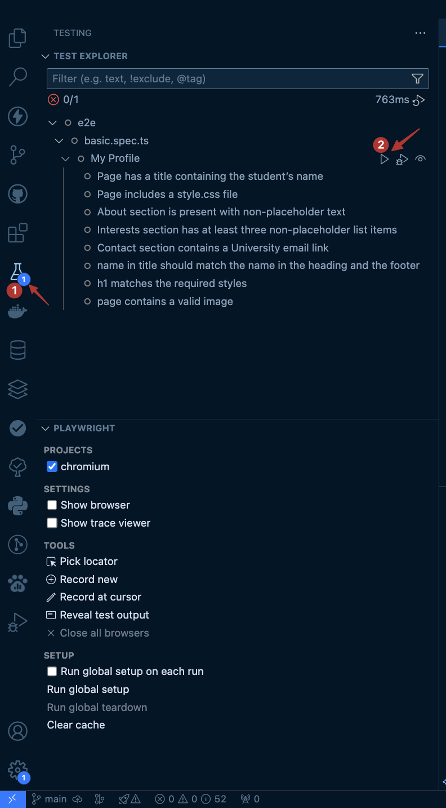

## Overview

In this assignment, you will create a simple personal profile webpage to refresh your knowledge of HTML and CSS. This assignment will also serve as your introduction to our workflow this semester using GitHub Classroom. You will accept an assignment link which will create a GitHub repository for you, and you will clone it, commit changes to it, and push those changes back to GitHub. We will use GitHub Actions to run automated tests that help verify certain requirements of your webpage are met.

## Learning Outcomes

1. **Git & GitHub Proficiency:**
   - Learn how to accept and clone a GitHub Classroom assignment repository.
   - Practice making commits, writing commit messages, and pushing changes to GitHub.
   - Understanding basic Git branching, staging, and version control workflows.
2. **HTML and CSS Refreshers:**
   - Reinforce understanding of Standard HTML5 Structure (doctype, html, head, body).
   - Build a simple, well-structured webpage using Semantic HTML tags.
   - Apply fundamental CSS styling principles (selectors, fonts, colors, layout).
3. **Assignment Workflow**

### Objectives

By the end of this assignment, you should be able to:

- Set up a local development environment and pull code from a GitHub Classroom repository.
- Create a basic HTML5 page with a structured layout: header, main content, and footer.
- Apply CSS to style your page consistently, including fonts and basic colors.
- Run automated tests and checks locally to identify issues and errors in code.
- Fix issues in response to test feedback and/or warnings.
- Commit changes to GitHub and view automated test results provided by GitHub Actions.

## Prerequisites

- Basic familiarity with HTML tags, attributes, and semantic elements.
- Basic familiarity with CSS selectors and simple styling rules.
- A complete local development environment per the guides and the instructions in the syllabus including:
  - Installing Visual Studio Code
  - Installing git
  - Installing Node.js (to run the automated code checks locally on your computer if desired)

---

## Instructions

The assignment is broken into 3 parts to make it easy for you to follow along and to take breaks if you wish.

1. 🔰 **Getting Started**
2. **Part 1**: Making Updates to HTML and CSS
3. **Part 2**: Run the automated checks locally to check for the correctness of your code
4. **Part 3**: Hosting the webpage using GitHub Pages
5. 🏁 **Submission**

---

### **Getting Started: Accepting the assignment**

1. **Accept the assignment on GitHub Classroom using [the following invitation link](https://classroom.github.com/a/CoKnXJh5)**
2. **Follow the prompts to create your individual repository on GitHub.** This will be private, visible only to you and the teaching staff.
3. **Clone the repository locally to your computer.**  
   You can follow this guide on how to clone a GitHub Repo using the tool of your choice (Visual Studio Code, Command Line Interface, or GitHub Desktop).
4. Open the cloned directory using Visual Studio Code
   - If you see a prompt from VSCode asking if you trust the authors, accept it.
   - You may see a pop-up window with recommended extensions — feel free to accept or reject.
5. You will find the following files and directories:
   - `index.html`: provided starter file
   - `style.css`: provided starter file
   - `tests/`: directory containing automated checks and tests – don't modify
   - `package.json` and `package-lock.json`: for Node.js dependencies – don't modify
   - `.vscode/`: editor configuration files
     - One setting automatically formats your code when you save. You're welcome.

Now we're ready. Happy Hacking 🧑‍💻

---

### **Part 1: Editing HTML and CSS**

1. Update the `index.html` file:
   a. Include your name:

   - Change the `<title>` tag to include your name.
   - Change the `<h1>` tag to include your name.
   - Change the `<footer>` tag to include your name.
   - 🚩 Commit: `"Included my name in the webpage"`
     b. Replace the placeholder text in the “About Me” section with a 2–3 sentence intro.
     c. Update the “Interests” section with at least 3 hobbies.
   - 🚩 Commit: `"Updated the about me and interests sections"`
     d. Update the email in "Contact Me" with your `mail.uc.edu` email.
   - 🚩 Commit with a descriptive message.
     e. Link the `style.css` file in the `<head>` section.
   - 🚩 Commit with a descriptive message.
     f. Add an image in the `<header>` before the `<h1>`.  
      Use: `./assets/images/uc-logo.png` and include descriptive `alt` text.
   - 🚩 Commit with a descriptive message.

2. Update the `style.css`:
   a. Change `h1` styling:

   - Set color to `#860707` or `rgb(134,7,7)`
   - Make text bold (use CSS only)
   - Set font size to `32px` or `2rem`

     - 👾 **Extra Credit**:  
       Why do `32px` and `2rem` result in the same font size, and when wouldn’t they?

   - 🚩 Commit with a descriptive message.

---

### **Part 2: Run Automated Tests**

This step helps confirm if you've met all the requirements.

**Prerequisite**: Node.js must be installed.

1. Open your terminal (Terminal, iTerm, Git Bash, etc.)  
   You can also use [VS Code's integrated terminal](https://code.visualstudio.com/docs/editor/integrated-terminal).
2. Navigate to your project directory using `cd`.
   - 🦉 Tip: In VSCode, the terminal opens at the project path.
   - 🦉 Tip: You can drag the folder into the terminal after typing `cd`.
3. Run: `npm install`
4. Run: `npm test`
   - The test suite will check for correctness. Any failed check means a requirement was missed.
5. Fix any issues before submitting.

#### 🦉 Bonus Tip: Using Playwright in VSCode

Install [Playwright Test for VSCode](https://marketplace.visualstudio.com/items?itemName=ms-playwright.playwright).  
This allows you to view test results directly in the IDE.  
(You still need to run `npm install` first.)

---

### **Part 3: Hosting with GitHub Pages**

Follow GitHub’s guide to publish your `main` branch using GitHub Pages:  
👉 [Publishing with GitHub Pages](https://docs.github.com/en/pages/getting-started-with-github-pages/configuring-a-publishing-source-for-your-github-pages-site)

---

### **Submission**

✅ Ensure your code is pushed to GitHub.  
If it’s not visible in your repository, we can’t grade it.

Submit:

1. **Link to your GitHub repository**  
   Format: `https://github.com/IT3049C-Students/<assignment-name>-<your-github-name>`

2. **Link to your GitHub Pages site**  
   Format: `https://it3049c-students.github.io/<assignment-name>-<your-github-name>`

3. **Optional:** Your response to the extra credit question

---

## Grading Criteria

Most of your grade is based on correctness as indicated by the automated tests.  
You will also be graded on making frequent, meaningful git commits and correctly setting up GitHub Pages.  
Refer to the assignment rubric for full grading details.

---

## Resources

Here are some helpful references:

- [W3Schools HTML Tutorial](https://www.w3schools.com/html/)
- [W3Schools CSS Tutorial](https://www.w3schools.com/css/)
- [Git Documentation](https://git-scm.com/doc)
- [GitHub Guides: Getting Started](https://guides.github.com/)
- [Playwright Documentation](https://playwright.dev/)

### Help and Support

For help, post on the course discussion board on MS Teams.  
You can also attend office hours with the TA or instructor for live support.
